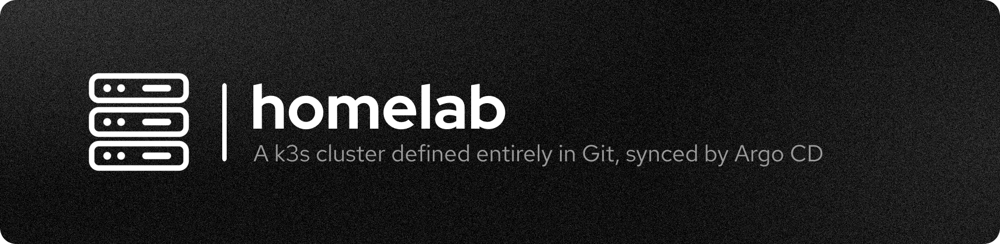
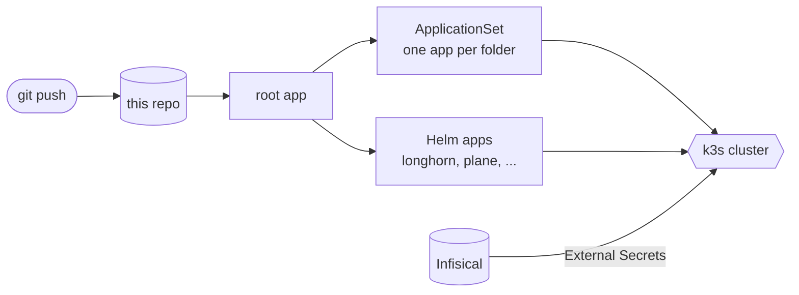
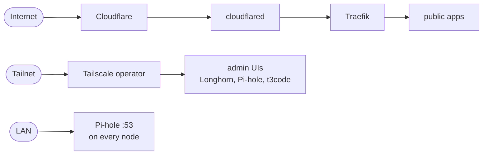
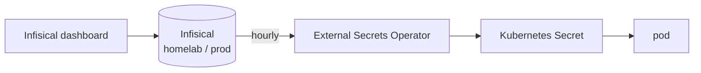

<h1 align="center">
  <br>
  <a href="/"></a>
  <br>
</h1>

<p align="center">
  
  
  
  
  
</p>

GitOps repo for my homelab: a 7-node [k3s](https://k3s.io) cluster (3 HP
minis, 4 Raspberry Pi 5s). [Argo CD](https://argo-cd.readthedocs.io) keeps the
cluster equal to `main`. **Change a YAML file, push, done.** Nothing is applied
by hand.

## How it works



- `bootstrap/argocd/root.yaml` is applied once. It watches
  `bootstrap/argocd/applications/`.
- The **ApplicationSet** there turns every folder `apps/<group>/<app>/` into an
  Argo CD app named `<app>`, in namespace `<app>`.
- **Helm apps** have their own Application file in the same folder, because
  their chart values live there.
- **Secrets** live in Infisical, not in git. See [Secrets](#secrets).

## Traffic



No router ports are open. `cloudflared` dials out to Cloudflare. Admin UIs
are reachable only over Tailscale. Storage is [Longhorn](apps/infra/longhorn)
(3 replicas); the media library is an SMB share on the NAS.

## Apps

| Group | Apps |
| --- | --- |
| **infra** | [cloudflared](apps/infra/cloudflared) · [external-secrets](apps/infra/external-secrets) · [kured](bootstrap/argocd/applications/kured.yaml) · [longhorn](apps/infra/longhorn) · [monitoring](apps/infra/monitoring) · [node-maintenance](apps/infra/node-maintenance) · [pihole](apps/infra/pihole) · [tailscale](apps/infra/tailscale) |
| **media** | [arr-stack](apps/media/arr-stack): qBittorrent, Sonarr, Radarr, Lidarr behind a ProtonVPN sidecar |
| **home** | [homeassistant](apps/home/homeassistant) |
| **tools** | [gitlab](apps/tools/gitlab) + [gitlab-runner](apps/tools/gitlab-runner) · [n8n](apps/tools/n8n) · [plane](apps/tools/plane) · [stirling-pdf](apps/tools/stirling-pdf) · [t3code](apps/tools/t3code) · [twenty](apps/tools/twenty) |
| **sites** | [docs](apps/sites/docs) · [groepshike](apps/sites/groepshike) · [jotihunt](apps/sites/jotihunt) · [portfolio](apps/sites/portfolio) · [windesheim-readers](apps/sites/windesheim-readers) |

Apps with more moving parts have a `README.md` in their folder.

## Layout

```text
apps/<group>/<app>/        Kustomize base per app (+ README.md, externalsecret.yaml)
apps/_template/            starting point for a new app
bootstrap/argocd/          root app, the ApplicationSet, and the Helm apps
docs/                      cluster notes: nodes, storage, HA, recoveries
images/                    custom images, built by .github/workflows/
scripts/                   one-off helpers (secret migration, restores)
```

## Add an app

1. `cp -r apps/_template apps/<group>/<app>` and fill in the manifests.
   The folder name is the app name and namespace, and must be unique.
2. Secrets: add a folder in Infisical and an `externalsecret.yaml`
   ([how](apps/infra/external-secrets/README.md#using-it-in-an-app)).
3. Push. The ApplicationSet picks it up.

Removing a folder does **not** delete the app (safety). Delete it in Argo CD
once you mean it.

## Secrets



- Edit values in the [Infisical dashboard](https://eu.infisical.com), never
  with `kubectl`.
- One folder per Secret. The full list is in
  [apps/infra/external-secrets](apps/infra/external-secrets/README.md#all-secrets).
- The only secret made by hand is ESO's own Infisical login,
  `infisical-universal-auth`. Keep a copy in a password manager.

## Bootstrap a new cluster

```bash
kubectl create namespace argocd
kubectl apply -n argocd -f https://raw.githubusercontent.com/argoproj/argo-cd/stable/manifests/install.yaml
kubectl create namespace external-secrets
kubectl -n external-secrets create secret generic infisical-universal-auth \
  --from-literal=clientId='...' --from-literal=clientSecret='...'
kubectl apply -f bootstrap/argocd/root.yaml
```

Node prep (Longhorn, SMB) is in [docs/](docs).

## Docs

- [High availability](docs/high-availability.md) · [Raspberry Pi 5 nodes](docs/raspberry-pi-5-nodes.md) · [Node storage](docs/node-storage.md)
- [Longhorn prerequisites](docs/longhorn-prerequisites.md) · [Monitoring migration](docs/monitoring-migration.md)
- Incidents: [pi52 recovery](docs/pi52-recovery.md) · [Pi decommission](docs/pi-decommission.md)

<sub>Header image: `.github/media/generate-header.sh`, adapted from
[resend/n8n-nodes-resend](https://github.com/resend/n8n-nodes-resend/tree/main/.github/media).</sub>
